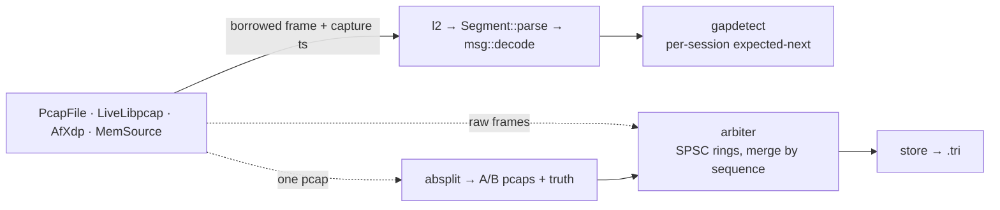

# Tributary

IEX-TP v1.0 / DEEP 1.0 / TOPS 1.6 feed capture, exact gap detection, and A/B
arbitration. Rust workspace: 8 library crates + 1 CLI, ~3,700 lines. Research
prototype — the file-based pipeline is verified end to end, the live NIC path is
not (see [Status](#status)).

[Benchmarks](BENCHMARKS.md) · [AF_XDP notes](docs/AFXDP.md) · [Storage design](crates/store/RETENTION.md)

## Quick start

```sh
cargo test
cargo build --release

B=./target/release/tributary
$B gaps    fixtures/deep_20191224_1430.pcap.gz
$B absplit fixtures/deep_20191224_1430.pcap.gz --out-dir out --loss-a 0.05 --loss-b 0.05
$B arbiter out/a.pcap out/b.pcap --truth out/truth.json --out out/merged.tri
$B replay  fixtures/deep_20191224_1430.pcap.gz --cores 4
$B replay  fixtures/deep_20191224_1430.pcap.gz --arbiter --rate 1m
$B store   info out/merged.tri
```

A full day of IEX HIST data: `scripts/fetch_sample.sh 20191224 DEEP` (~172 MB
gzipped, 695 MB inflated). `fixtures/` is committed; `data/` and `out/` are
git-ignored.

## Scope

Four requirements:

1. Capture at line rate; target 60 Mpps aggregate.
2. Detect lost packets exactly, from protocol sequence numbers.
3. Merge the A and B copies of each feed into one gap-free stream.
4. Store ~5 TB/day, seekable by `(session, sequence)` and by time.

Requirement 2 is exact, not heuristic: every IEX-TP segment carries `first_seq`
and `message_count`, heartbeats included.

## Target math

Minimum frame on the wire: 64 B + 8 B preamble/SFD + 12 B IFG = 84 B = 672 bit.

| | |
| --- | --- |
| 10 GbE, minimum frame | 10e9 / 672 = 14.88 Mpps (cap of the 10G test box) |
| 60 Mpps, minimum frame | 60e6 × 672 = 40.3 Gbit/s |
| 60 Mpps, 170 B on wire | 60e6 × 1360 = 81.6 Gbit/s |
| Per-core budget at 60 Mpps | 8 cores: 133 ns/pkt · 12: 200 ns · 16: 267 ns |

Measured software cost: 23.6 ns/frame for L2 + IEX-TP + full decode, and
19.8–28.0 ns/packet for parse + decode + gap-detect in replay, memory-resident
([BENCHMARKS.md](BENCHMARKS.md) §1, §2, §5). That excludes syscalls, locks,
allocation and DMA misses.

The kernel socket path costs microseconds per packet, ~10³ over budget. AF_XDP
replaces it: NIC DMA into a user-space UMEM, RX descriptors read in user space, a
syscall only to wake a sleeping driver. Sharding: RSS hashes the UDP 4-tuple, so
one multicast group (one session) lands on one queue → one AF_XDP socket, one
pinned thread, all per-session state per queue; an SPSC ring hands frames to the
arbiter.

## Architecture



Hot-path rules:

- No allocation after start-up: gap lists are pre-reserved; reorder slots (128 B)
  and ring frames (1536 B) are fixed size.
- No locks: SPSC rings; all other state is thread-local. Reports are built off
  the hot path.
- Parsing is a bounds check followed by `ptr::read_unaligned` of a
  `#[repr(C, packed)]` struct — [`read_pod`](crates/tp-parse/src/lib.rs#L62), the
  parser's only `unsafe`. Fields are `from_le`'d into host structs.
- L2–L4 has a fixed-shape fast path (Ethernet II, IPv4 without options, UDP)
  with an `etherparse` fallback: 1.26 ns vs 13.1 ns per frame.
- Capture backends deliver frames by callback as borrowed slices, so nothing
  copies on the way in.

## Gap detection

Per session, `expected_next = first_seq + message_count` of the last in-order
segment.

| Observation | Result |
| --- | --- |
| `first_seq == expected_next` | in order (a heartbeat confirming the frontier) |
| `first_seq > expected_next` | gap `[expected_next, first_seq-1]` |
| `first_seq < expected_next` | duplicate, or a reordered segment that fills part of a recorded gap (range subtraction) |

Heartbeats (`message_count == 0`) carry `expected_next`, so a gap surfaces at
most one heartbeat late. Sequences restart per session.

Tests ([`gapdetect/tests/ground_truth.rs`](crates/gapdetect/tests/ground_truth.rs)):
the real fixture reports 0 gaps; copies with known removals, swaps and duplicates
produce exactly the injected ranges and counts.

## A/B arbitration

Feeds are published on two multicast groups over separate paths; loss on A and B
is near-independent, so arbitration cuts loss from `p_A` to ≈ `p_A · p_B`.

Per session, `next` is the next sequence to emit:

- `seq == next` → emit, borrowed from the wire; first site wins.
- `seq < next` → duplicate, or `late_after_gap` if already declared lost.
- `seq > next` → copy into the reorder window (`window` slots, `seq & mask`).
- `frontier[site]` = highest `first_seq + count` seen from that site, heartbeats
  included. When both frontiers pass `next`, no site can still deliver it, so
  `[next, min(frontier)-1]` becomes a residual gap and the window drains.
- The window is also the maximum A/B lag; overflow forces an advance. Site EOF
  sets its frontier to ∞.

Each site must deliver in order (single multicast path); intra-site reordering is
counted as `late_after_gap`.

Ground truth comes from `absplit`: one real pcap fanned into A and B with
independent seeded loss and delay/jitter, recording exactly which sequences each
side dropped. [`arbiter/tests/ground_truth.rs`](crates/arbiter/tests/ground_truth.rs)
asserts, over 18 configurations single-threaded and 3 seeds through the SPSC
pipeline with two reader threads: output strictly ordered, duplicate-free and
byte-identical to the source; residual gaps == `dropped_A ∩ dropped_B`; all other
messages present; per-site loss and recovery bookkeeping == truth.

Full day: 9.1 M packets in, 4,742,744 messages out, 1,919 lost by both, residual
== truth (`tributary arbiter --truth`).

## Clocks and cross-site ordering

Arbitration by sequence number needs no clock. Everything else does: which site
was faster, ordering across sessions and feeds, latency attribution against IEX's
three clocks (matching-engine `Message.timestamp`, gateway `TpHeader.send_time`,
capture time). That requires PTP (IEEE 1588) with a GNSS-disciplined grandmaster
per site, boundary/transparent clocks in the switches, and NIC hardware
timestamps taken at the PHY — sub-µs cross-site agreement.

`Packet.ts_ns` and `Out.capture_ns` are first-class and the store indexes on
capture time; [docs/AFXDP.md](docs/AFXDP.md) describes the
`bpf_xdp_metadata_rx_timestamp` path (kernel ≥ 6.3). Not implemented: PTP
plumbing. The sample timestamps are IEX's own, and the two test "sites" are one
file with a synthetic delay.

## Status

| Component | State |
| --- | --- |
| Parser, DEEP 1.0 + TOPS 1.6 | message-for-message match against `iex_parser` on both fixtures |
| Gap detection | 0 gaps on both full days; exact on injected drops, swaps, duplicates |
| A/B arbitration | ground truth PASS on the fixture (18 configs) and the full day |
| Replay / multi-core | measured on macOS only; no core pinning available |
| Storage (`.tri`) | write and seek verified; the 5 TB/day design is documentation only ([RETENTION.md](crates/store/RETENTION.md)) |
| Live capture, libpcap | behind a feature flag; not exercised |
| AF_XDP | Linux-only; compile-checked in Docker; never run on a NIC |
| PTP / cross-site clocks | not implemented |

## Spec assumptions

Cross-checked against `rob-blackbourn/iex_parser` and real HIST data; not re-read
from the PDFs. Layout constants:
[crates/tp-parse/src/lib.rs](crates/tp-parse/src/lib.rs#L7).

- IEX-TP header, 40 B, little-endian: version `u8` @0, reserved @1, message
  protocol id `u16` @2 (`0x8003` TOPS 1.6, `0x8004` DEEP 1.0), channel `u32` @4,
  session `u32` @8, payload length `u16` @12, message count `u16` @14, stream
  offset `u64` @16, first message sequence `u64` @24, send time `i64` ns @32.
- Payload is `message_count` × {`u16` length, body}; message `i` has sequence
  `first_seq + i`.
- Message bodies: type `u8` @0, flag/char @1, timestamp `i64` @2, symbol
  `[u8; 8]` @10, then type-specific fields. Prices are `i64 × 1e-4` USD. Table in
  [msg.rs](crates/tp-parse/src/msg.rs).
- Heartbeat: `message_count == 0`, `first_seq` = next expected sequence.
- IEX HIST files: pcapng, µs timestamps, A-side only, already merged by IEX.

## Layout

```
crates/tp-parse    IEX-TP + DEEP/TOPS parsing; tests/golden.rs = reference-parser equivalence
crates/capture     CaptureSource; PcapFile, PcapWriter, LiveLibpcap[libpcap], AfXdp[afxdp,linux]
crates/gapdetect   per-session sequence tracking; tests/ground_truth.rs
crates/absplit     A/B fan-out with seeded loss + truth
crates/arbiter     arbitration core + two-thread pipeline; tests/ground_truth.rs
crates/replay      in-memory rate-controlled replay, multi-core workers, per-pass seq rewrite
crates/metrics     counters, hdrhistogram
crates/store       .tri writer/reader; RETENTION.md
bins/tributary     CLI: gaps · absplit · arbiter · replay · store · live; tests/cli.rs
fixtures/          2 × 2,000-packet IEX samples + reference-parser goldens
scripts/           fetch_sample.sh, make_fixture.py, reference_golden.py, check_linux_afxdp.sh
docs/AFXDP.md      Linux run notes
```
